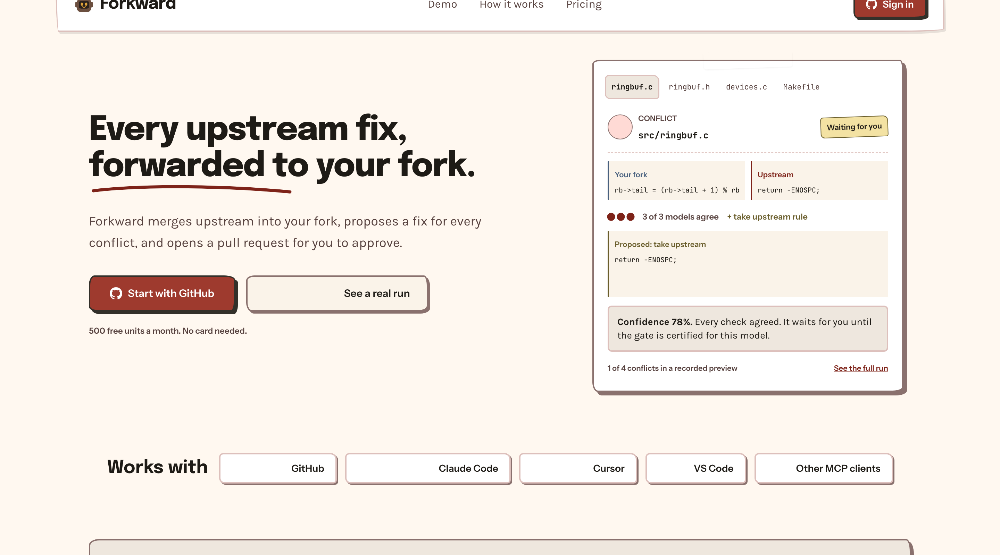
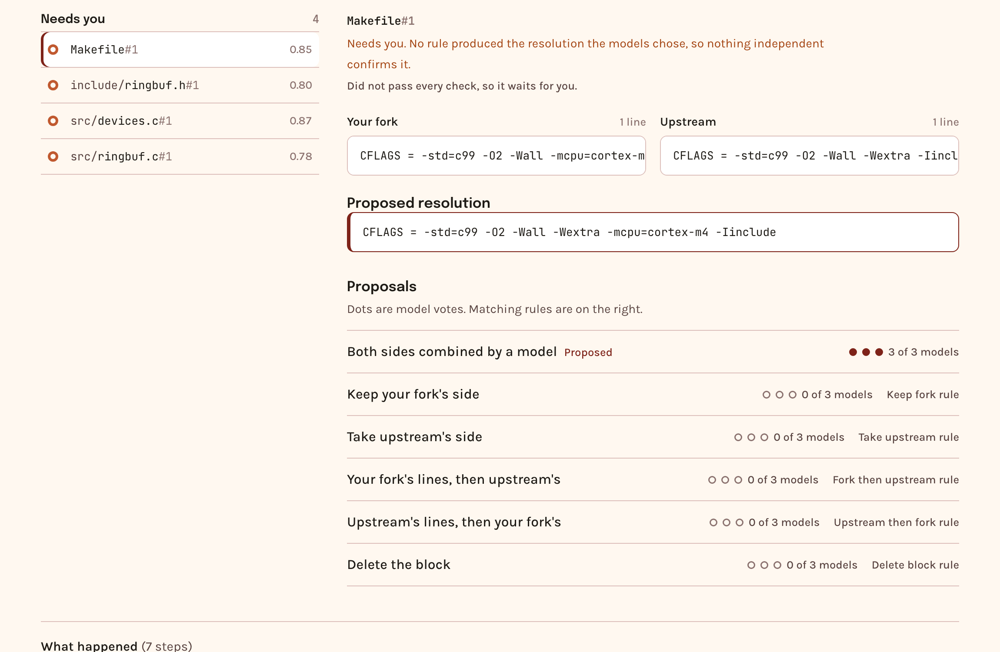

<h1 align="center">Forkward</h1>

<p align="center"><b>Every upstream fix, forwarded to your fork.</b></p>

<p align="center">
  <a href="https://mergesthat.work">mergesthat.work</a> ·
  <a href="https://mergesthat.work/demo">See a real run</a> ·
  <a href="https://mergesthat.work/how">How it works</a>
</p>

<p align="center"></p>

## Why

A fix upstream is not yet a fix in your fork. Device kernels fall 29 to 158 stable releases behind,
because every sync means hand-resolving merge conflicts, so security and stability fixes stall. The
same is true of any long-lived fork: Android vendor kernels, browser forks, database forks and the
internal forks most companies carry.

## How a sync works

1. **Connect a fork.** Sign in with GitHub, install the Forkward app on your fork and name the
   upstream it follows, such as `expressjs/cors@v2.8.5`.
2. **Sync.** Forkward merges upstream on a new `forkward/sync-*` branch. Seven deterministic rules
   and three model personas propose a resolution for every conflict, and they vote.
3. **The gate decides.** A resolution applies on its own only if it wins the vote, a rule agrees
   with the models, a classifier agrees, and its confidence clears a bar calibrated for that model.
4. **You review the rest.** Everything else waits in a draft pull request and in the web app, with
   both sides, the proposal and every alternative. Accept, edit or reject; Forkward commits your
   choices to the branch and marks the pull request ready.
5. **Merge, and it learns.** What you merge is remembered, so the same upstream change conflicting
   again reuses your fix. Syncs can run on a schedule.

<p align="center"></p>

## A record anyone can check

Each sync writes two memos to Solana devnet. The first, sent when the pull request opens, is a
hash of every decision the gate made. The second, sent on merge or close, is a hash of what the
reviewers actually kept, linked to the first. A prediction is on chain before its outcome, and
neither can be changed later. Anyone can recompute both:

```sh
uv run python -m forkward solana verify <tenant> <job-id>
```

Over time these pairs are the labelled data that calibrates the gate.

## Why not just ask an LLM

A single model answer is a guess with no error rate. Forkward searches, then measures.

- **Deterministic candidates first.** A small resolution algebra (keep vendor, take upstream, both
  orders, each side's change replayed onto the other) generates candidates with no model call.
- **Many proposers, one vote.** Several LLM personas add candidates, and a hunk is chosen by
  agreement across independent proposers, not by trusting one.
- **The gate, not the model, decides what merges.** A hunk auto-applies only if it wins a clear vote
  that includes a deterministic operator, a classifier agrees with it, and its confidence clears a
  threshold calibrated per model on held-out data. Model text can never approve itself.
- **It learns without fine-tuning.** A reflector and curator turn mistakes into a playbook, a search
  keeps only strategies that beat the incumbent on validation, and a shared cache reuses a
  resolution whenever the same upstream change conflicts again.
- **Scored against real engineers.** The benchmark is real Linux kernel vendor merges (NXP, ST,
  Rockchip), and the answer key is what each vendor actually committed.

## Results, stated honestly

We taught Forkward on NXP's kernel merges, picked the best version on STMicroelectronics' merges,
locked it, and then ran it once on Rockchip's merges, which it had never seen. A merge conflict
counts as correct only if Forkward's resolution matches, line for line, what Rockchip's own
engineers committed.

The version we locked combines three model personas and the rule-based candidates, which vote on
each conflict, with a short list of lessons the system wrote for itself from its NXP mistakes, such
as "if the vendor's change generalizes the upstream one, take the upstream form and add the vendor's
extra logic." Every number below uses the same model, DeepSeek V4.1 Flash.

| Approach | Conflicts resolved like Rockchip did (of 71) |
|---|---|
| A single model call, no lessons | 33 (46.5%) |
| Always keep the fork's own code | 51 (71.8%) |
| Forkward | 54 (76.1%) |

- Forkward got 21 more conflicts right than a single model call.
- Most Rockchip conflicts are resolved by keeping the fork's code, so that simple rule is hard to
  beat. Forkward beats it by 3 conflicts, which is too few to be statistically meaningful yet.
- Forkward makes about four model calls per conflict, against one for the single call.
- Its safety gate has not yet earned the right to merge anything alone, so today every conflict
  goes to a person. Proving a low error rate takes far more checked resolutions than one benchmark
  holds, which is what a shared sync service collects.

Full numbers are in `results/`.

## Stack

| Layer | What it uses |
|---|---|
| Web app | Next.js 16, React 19, Tailwind, Better Auth with GitHub sign-in |
| Engine | Python 3.11+, DBOS durable workflows, FastMCP server for coding agents |
| Models | DeepSeek V4.1 Flash on Vultr Serverless Inference; Luminal, DeepSeek, Gemini, Anthropic or any local OpenAI-compatible server |
| Data | Postgres on Tiger Cloud with forced row-level security per workspace; run logs in a TimescaleDB hypertable |
| GitHub | A GitHub App with short-lived installation tokens, draft pull requests and the Forkward gate check |
| Trust | Solana devnet Memo program for decision and outcome anchors |
| Auth for agents | Auth0 as the MCP authorization server |
| Hosting | Vultr VM, Caddy, systemd, served at mergesthat.work |

## Run it locally

```sh
uv sync && cp .env.example .env   # add LUMINAL_API_KEY or another provider
uv run python -m forkward sync <repo> <owner/name@ref>
```

The web app lives in `frontend/`:

```sh
cd frontend && npm install && npm run dev
```

Checks: `uv run pytest`, `uv run ruff check .`, and in `frontend/`, `npm run typecheck` and
`npx vitest run`.

## Repository

| Path | Contents |
|---|---|
| `forkward/` | The engine: rules, agents, gate, scorer, sync, workflows, MCP server, Solana anchoring |
| `frontend/` | The site and web app |
| `dashboard/` | The agent observability board |
| `migrations/` | Postgres schema with row-level security |
| `results/` | Every reported number, regenerated by `python -m forkward report` |
| `tests/`, `e2e/` | Unit tests and an end-to-end harness with a fake GitHub |
| `deploy/` | Caddy, systemd units and the deploy script |
